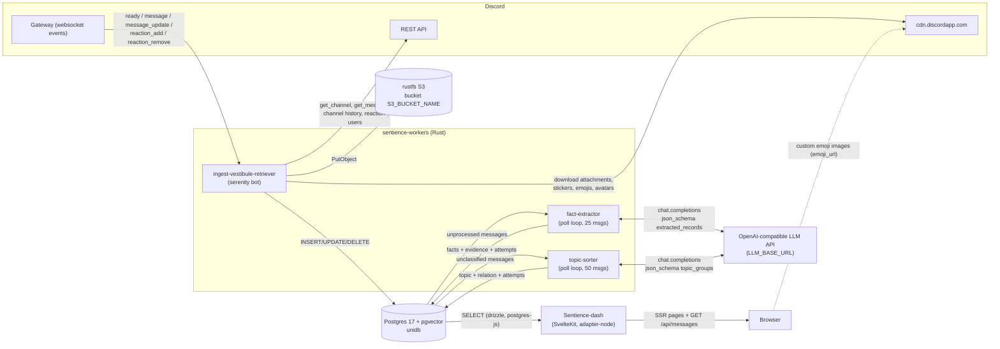
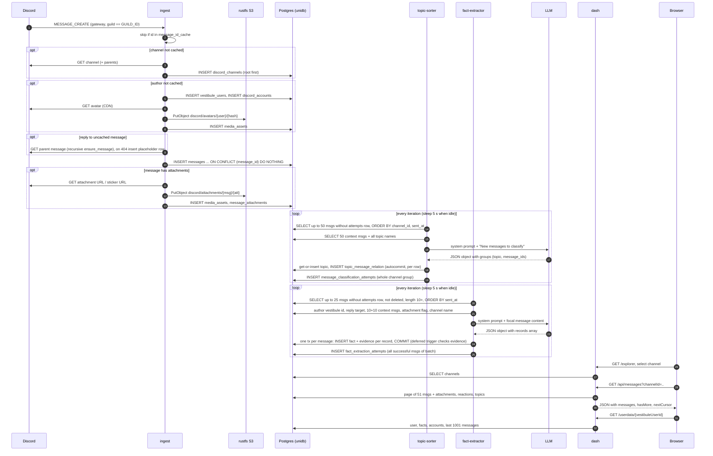

# Sentience / unidb — System Specification

Authoritative description of the Sentience system **as implemented** on `main`. Every statement here was checked against
the code; file references are `repo:path:line`.

| Repo | Commit described | Role |
|---|---|---|
| `Vimothy-s-Vestibule/unidb-schema` (this repo) | `c20a146` | Postgres schema (`schema/*.sql`) + Rust crate `unidb` (models, `scoring_prompt`) |
| `Creative-Difficulty/sentience-workers` | `c3432cb` | Rust workspace: `ingest-vestibule-retriever`, `fact-extractor`, `topic-sorter`; docker-compose stack |
| `Creative-Difficulty/Sentience-dash` | `1fe79e2` | SvelteKit dashboard reading unidb |

Workers pin `unidb` at git rev `a7a7c55` (`sentience-workers:Cargo.lock:4585`); `a7a7c55..c20a146` only touches `TODO.md`,
so models/schema are identical.

Conventions in this document: **W** = INSERT, **U** = UPDATE, **D** = DELETE, **R** = SELECT. "NN" = `NOT NULL`.
"Known gap" marks behaviour that is a defect or an open question today (fixes may be in flight; see §11).

---

## 1. Purpose

Sentience ingests everything posted on **one Discord server (guild)** into a shared Postgres database (unidb), then uses
LLMs to (a) extract durable **facts, activities and skills** about each message author and (b) group messages into
**topics**. A web dashboard shows server activity charts, a conversation explorer with topic highlighting, and per-user
pages with the extracted facts. The schema is also designed (but not yet used) for linking users to external platforms
(YouTube, GitHub, Strava, ...), presence tracking, personality scoring and a generic job queue.

## 2. Glossary

| Term | Meaning |
|---|---|
| **unidb** | The shared Postgres 17 + pgvector database, and the Rust crate `unidb` that models it. |
| **vestibule user** | Row in `vestibule_users`: the canonical *person* (UUID). May own 0..n Discord accounts and 0..n connected accounts. All extracted facts hang off this id. ("Vestibule" is the community the system was built for.) |
| **discord account** | Row in `discord_accounts`, keyed by the Discord user snowflake; FK to exactly one vestibule user. Ingest creates exactly one vestibule user per new Discord account. |
| **snowflake** | Discord's 64-bit unsigned id. Stored as Postgres `bigint` / Rust `i64` via `u64 as i64` (all real snowflakes are < 2^63). Exceeds JS `Number.MAX_SAFE_INTEGER`, see §6.3. |
| **guild** | A Discord server. Ingest serves exactly one, set by `GUILD_ID`. |
| **topic** | Row in `topic`: short lowercase label ("rust borrow checker") created ad hoc by the topic-sorter LLM; messages link to it via `topic_message_relation`. |
| **record / fact / activity / skill / emotion** | Row in `user_facts_and_activities`, discriminated by `record_type` (`activity_record_type`). *fact* = stable knowledge (location, employer); *activity* = something done with a timeline (`started_at`/`ended_at`); *skill* = competency with `level` 0–10; *emotion* = enum value exists but the LLM schema never emits it. |
| **evidence** | Row in `fact_and_activity_evidence`: links a record to exactly one source (message, YouTube comment, external content or presence row) with `weight` and `reasoning`. Every record must have ≥1 evidence row at commit (deferred trigger). |
| **attempts table** | `fact_extraction_attempts` / `message_classification_attempts`: one row per message a worker has *finished*. Row present = processed (successfully, possibly with zero output); no row = not yet processed or failed. See ADR 0002. |
| **placeholder message** | Synthetic `messages` row inserted for a replied-to message that no longer exists on Discord (§8). |
| **Deleted User** | Seeded vestibule user `3d299903-2abf-4930-b2b9-8b083c1d21b2` with Discord account `0` (`deleteduser`), author of placeholder messages. |
| **rustfs** | Self-hosted S3-compatible object store holding downloaded Discord media. |
| **media asset** | Row in `media_assets` describing one S3 object (key, content type, size, SHA-256). |

## 3. Architecture



There is **no service-to-service communication**: every component integrates only through unidb tables (ADR 0001).
The dash never reads S3 (attachments are listed by object key only) and never calls the workers.

### 3.1 Lifecycle of one message



## 4. Components

### 4.1 unidb-schema (this repo)

| Item | Detail |
|---|---|
| `schema/NN_*.sql` | Hand-written DDL. Concatenating all files in **filename order** yields the full schema (`Makefile:3-6` → `schema.sql`, git-ignored). Order encodes FK dependencies; cross-cycle FKs are added later with `ALTER TABLE` (`schema/03_users_and_accounts.sql:35-43`). |
| Seed data | `03`: Deleted User + Discord account `0`; `06`: 6 `social_platforms` rows with `gen_random_uuid()` ids. |
| Rust crate `unidb` 0.3.0 | edition 2021; `ormlite` 0.24 `Model` derive + `sqlx::Type` enums (`src/models/*.rs`), re-exported at crate root (`src/lib.rs:4`, `src/models.rs:32-47`). Depends on `serenity` 0.12 only for `TryFrom<ChannelType>` (`src/models/enums.rs:36-52`). |
| `scoring_prompt()` | Builds a personality-scoring prompt (§7.3). **Not called by any service.** |
| Migrations | **None.** The schema is applied only when a Postgres data directory is initialised (§10.4). |
| Tests | 2 unit tests asserting `HexacoTraits`/`BehavioralTraits` field names equal the `HEXACO`/`BEHAVIORAL` trait lists (`src/scoring_schema.rs:134-181`). |

### 4.2 ingest-vestibule-retriever (`sentience-workers/ingest-vestibule-retriever`)

Serenity 0.12 Discord bot; read-only towards Discord (sends nothing). Gateway intents: `GUILD_MESSAGES | MESSAGE_CONTENT |
GUILDS | GUILD_MEMBERS | GUILD_MESSAGE_REACTIONS` (`src/main.rs:56-60`). No presence intent → `discord_user_presence`
is never written.

Startup (`src/main.rs:20-83`): connect pool (max 5) → load three in-memory `HashSet<i64>` caches (`messages.message_id`,
`discord_channels.channel_id`, `discord_accounts.discord_user_id`) → build S3 client → build serenity client → write
`/tmp/ready` → `client.start()`.

| Event (`src/discord_handler.rs`) | Filter | Action (spawned tokio task) |
|---|---|---|
| `ready` (:37) | — | spawn `run_historical_scan` |
| `message` (:51) | `msg.guild_id == GUILD_ID` | `ensure_message` |
| `message_update` (:73) | full new message available and guild matches | `handle_message_edit` |
| `reaction_add` (:101) | guild matches | `handle_reaction_add` |
| `reaction_remove` (:125) | guild matches | `handle_reaction_remove` |
| message delete, bulk delete, reaction-remove-all, channel/member updates | — | **not handled** (`lib.rs:24-35` `delete_message` exists but is never called) |

`ensure_message` (`src/handlers/message.rs:75-191`): cache hit → return. Else `ensure_discord_channel` (fetches channel and
all uncached parents via REST, inserts root-first; insert errors logged and ignored, cache updated anyway,
`handlers/channel.rs:62-88`) → `ensure_user` → resolve reply parent (recursively `ensure_message` the parent fetched via
REST; on HTTP 404 insert placeholder, :129-148) → `INSERT ... ON CONFLICT (message_id) DO NOTHING` (:159-174). System
messages (joins, boosts, pins, …) get synthetic English content (`system_message_content`, :10-66). **Only if the message
has attachments**, `insert_message_attachments` and `insert_stickers` run (:180-188) — sticker-only messages store no
stickers (known gap).

`ensure_user` (`handlers/discord_user.rs:7-119`): cache hit → return. Insert `vestibule_users` (nickname =
`global_name` or `name`), then `discord_accounts` (separate statements, no transaction; account insert error is only
logged, cache updated regardless). If the user has a custom avatar and no `media_assets` row with that object key,
download it, `PutObject`, insert `media_assets` (S3 failure is logged and the DB row is still inserted). The avatar asset is
**not linked** to the account (no FK exists; unidb `TODO.md:5`).

`handle_message_edit` (`handlers/message_edit.rs:8-46`): `ensure_message` first, then if `edited_timestamp` is set, read
current `content` as `old_content`, insert `message_edits`, `UPDATE messages SET content, last_edited`. Because
`ensure_message` may have just inserted the *new* content, the recorded `old_content` can equal the new content (known
gap).

Reactions: `handle_reaction_add` fetches the message via REST, `ensure_message`, resolves/creates the emoji
(`handlers/emoji.rs`; custom emojis are downloaded as webp to S3), then plain `INSERT` (no `ON CONFLICT`,
`handlers/reaction.rs:96-107`). `handle_reaction_remove` hard-`DELETE`s the matching row (:47-54). Historical scan uses
`INSERT ... ON CONFLICT (message_id, user_id, emoji_id) DO NOTHING` (`historical/reactions.rs:60-71`).

Historical scan (`historical/scan.rs:6-86`): for each channel returned by `guild.channels()` (threads are **not**
included), page backwards 100 messages at a time until empty or error, **buffer all messages in memory**, then process
oldest→newest: `ensure_message` + fetch every reaction's users (paged by 100) + insert reactions. Runs on every `ready`
event (startup and every gateway re-identify), re-walking the whole guild history each time.

### 4.3 fact-extractor (`sentience-workers/fact-extractor`)

Infinite loop (`src/extractor.rs:191-247`), constants `BATCH_SIZE=25`, `IDLE_SLEEP=5s`, `MIN_CONTENT_LEN=10`,
`CONTEXT_SIZE=10` (:166-169).

1. Batch query (:198-214): messages with no `fact_extraction_attempts` row, `deleted_at IS NULL`,
   `content != '[deleted message]'`, `char_length(content) >= 10`, `ORDER BY sent_at LIMIT 25`.
2. Per message, sequentially (`process_message`, :250-348): author's `vestibule_user_id` (`fetch_one`); reply target
   (non-deleted); up to 10 non-deleted messages before and 10 after in the same channel (reply target removed from
   context); `has_attachments` (non-deleted attachment rows); channel name.
3. One chat-completions call (§7.1). Response content parsed as `{"records":[...]}`.
4. If ≥1 record: one transaction inserting, per record, a `user_facts_and_activities` row built by `build_fact`
   (:551-592) and a `fact_and_activity_evidence` row (`message_id` = focal message, `weight = confidence`,
   `reasoning` from LLM).
5. After the whole batch: `INSERT INTO fact_extraction_attempts SELECT UNNEST($ids) ON CONFLICT DO NOTHING` for messages
   whose `process_message` returned `Ok` (:237-244). If no message succeeded, sleep 5 s.

`build_fact` field mapping (LLM value → stored value):

| `kind` | `started_at` | `ended_at` | `level` | `is_current` |
|---|---|---|---|---|
| `activity` | LLM value or message `sent_at` | LLM value | `NULL` | `NULL` (prompt asks for it; code discards it) |
| `skill` | LLM value or message `sent_at` | `NULL` (discarded) | LLM value clamped to 0..10 | LLM value, default `true` |
| `fact` / `emotion` | `NULL` | `NULL` | `NULL` | LLM value, default `true` |

Always: `source='llm_extraction'`, `score_id=NULL`, `type_value_embedding=NULL`, `confidence` = LLM value **unclamped**,
`created_at=now()` (client clock), `id=Uuid::new_v4()`.

### 4.4 topic-sorter (`sentience-workers/topic-sorter`)

Infinite loop (`src/sorter.rs:60-118`), `BATCH_SIZE=50`, `CONTEXT_SIZE=50`, `IDLE_SLEEP=5s` (:55-57).

1. Batch query (:66-79): messages with no `message_classification_attempts` row and `content != '[deleted message]'`
   (**no `deleted_at` filter**), `ORDER BY channel_id, sent_at LIMIT 50`.
2. Group by `channel_id`; per channel (`classify_channel`, :121-286): fetch the 50 non-deleted messages before the
   group's earliest `sent_at` with their topic name (if any); fetch **all** `topic.name` values and list them in the
   system prompt (prompt grows without bound — known gap); call LLM (§7.2).
3. For each returned group: get-or-insert topic by exact name (`insert_topic`, :289-306, not atomic, `name` not UNIQUE);
   for each `message_id` that is in this channel group (others are logged and skipped), insert
   `topic_message_relation` unless the message already has one (:309-327). Every statement autocommits.
4. Channel groups that returned `Ok` get attempts rows (:108-115); failed channel groups are retried next iteration.

Effective rule: **a message has at most one topic** (enforced only by `WHERE NOT EXISTS`, not by a constraint).

### 4.5 Sentience-dash

SvelteKit 2, Svelte 5 runes, `@sveltejs/adapter-node`, drizzle-orm 0.45 over `postgres` (postgres-js) 3.4, Carbon
components/charts. DB handle created at module import (`src/lib/server/db/index.ts:6-10`; throws if `DATABASE_URL` is
unset). `src/lib/index.ts` re-exports `db` as the default export of `$lib`. **No authentication or authorisation.**

| Route | File | Data |
|---|---|---|
| `/` | `src/routes/+page.server.ts` | 24 h hourly counts, prev-24 h count, total non-deleted, top 10 users (24 h / all time), messages per day since first non-epoch message, channel type counts, messages per channel, messages per hour-of-day |
| `/explorer` | `src/routes/explorer/+page.server.ts` | `channels: {channelId: string, name: string, channelType: enum}[]` ordered by name; client then calls `/api/messages` |
| `/api/messages` | `src/routes/api/messages/+server.ts` | §7.4 |
| `/userdata` | `src/routes/userdata/+page.server.ts` | every Discord account with non-deleted message count (includes `deleteduser`) |
| `/userdata/[id]` | `src/routes/userdata/[id]/+page.server.ts` | `[id]` = vestibule user UUID: user, facts (all records, newest first), Discord accounts, ≤1000 newest non-deleted messages (+`truncated`) |

Page loaders catch errors and return `{ error: e.toString() }`, which the layout renders in a toast
(`src/routes/+layout.svelte:59-63`) — raw SQL and parameters reach the browser (verified: `/userdata/not-a-uuid`
returns `"Error: Failed query: select ... params: not-a-uuid,1"`). Custom emoji images are hot-linked from the Discord CDN
(`emoji_url`), not served from S3.

## 5. CRUD matrix

Rows = tables (all 23). "seed" = rows inserted by the schema files. Blank = never touched.

| Table | seed | ingest | fact-extractor | topic-sorter | dash |
|---|---|---|---|---|---|
| `discord_channels` | | R W | R | | R |
| `vestibule_users` | W | W | | | R |
| `discord_accounts` | W | R W | R | | R |
| `messages` | | R W U | R | R | R |
| `message_edits` | | W | | | |
| `message_attachments` | | R W | R | | R |
| `media_assets` | | R W | | | R |
| `discord_emojis` | | R W | | | R |
| `message_reactions` | | W D | | | R |
| `fact_extraction_attempts` | | | R W | | |
| `user_facts_and_activities` | | | W | | R |
| `fact_and_activity_evidence` | | | W | | |
| `topic` | | | | R W | R |
| `topic_message_relation` | | | | R W | R |
| `message_classification_attempts` | | | | R W | |
| `social_platforms` | W | | | | |
| `scores` | | | | | |
| `discord_user_presence` | | | | | |
| `connected_accounts` | | | | | |
| `youtube_videos` | | | | | |
| `youtube_comments` | | | | | |
| `external_content` | | | | | |
| `jobs` | | | | | |

Notes: ingest **U** on `messages` = edit handler (`content`, `last_edited`); `deleted_at` is never set by any running code.
ingest **D** on `message_reactions` = reaction removal. Nothing deletes from any other table.

## 6. Data model

### 6.1 Enums (`schema/00_extensions.sql`, `src/models/enums.rs`)

All Rust enums derive `sqlx::Type` with `rename_all = "snake_case"`, so variant `FooBar` ↔ label `foo_bar`. The dash
declares each with `pgEnum` (`Sentience-dash:src/lib/server/db/schema.ts:4-11`).

| SQL type | Labels (SQL order) | Rust enum: variants | Notes |
|---|---|---|---|
| `discord_channel_type` | `text, text_thread, public_thread, forum_post, voice, forum, stage, category` | `DiscordChannelType`: `Text` (default), `TextThread`, `PublicThread`, `ForumPost`, `Voice`, `Forum`, `Stage`, `Category` | `TryFrom<serenity ChannelType>`: Text, Voice, Forum, Category, Stage, PublicThread, PrivateThread→`TextThread`; others error → ingest falls back to `Text`. `ForumPost` is never produced. Drizzle lists `public_thread` last (order differs). |
| `activity_source` | `llm_extraction, external_content, manual` | `ActivitySource`: `LlmExtraction`, `ExternalContent`, `Manual` | only `llm_extraction` written |
| `presence_status` | `online, forced_online, absent, do_not_disturb, offline` | `PresenceStatus`: `Online`, `ForcedOnline`, `Absent`, `DoNotDisturb`, `Offline` | unused |
| `platform_access` | `public, oauth_required, unavailable` | `PlatformAccess`: `Public`, `OauthRequired`, `Unavailable` | seed only |
| `job_status` | `pending, in_progress, completed, failed` | `JobStatus`: `Pending` (default), `InProgress`, `Completed`, `Failed` | unused |
| `job_type` | `youtube_channel_retrieval, discord_channel_sync, strava_retrieval, linkedin_scrape` | `JobType`: `YoutubeChannelRetrieval`, `DiscordChannelSync`, `StravaRetrieval`, `LinkedinScrape` | unused |
| `activity_record_type` | `activity, fact, skill, emotion` | `ActivityRecordType`: `Activity`, `Fact`, `Skill`, `Emotion` | LLM schema allows only the first three |
| `youtube_video_broadcast_status` | `video, current_live, past_live, scheduled_live, none` | `YoutubeVideoBroadcastStatus`: `Video`, `CurrentLive`, `PastLive`, `ScheduledLive`, `None` | unused |

### 6.2 Type mapping conventions

| SQL | Rust (`unidb`) | Drizzle (dash) | JSON reaching the browser |
|---|---|---|---|
| `bigint` (snowflakes, sizes, counts) | `i64` | `bigint(..., { mode: "number" })` → JS `number` (**lossy above 2^53**) | dash casts ids with `::text` → `string` |
| `uuid` | `uuid::Uuid` | `uuid()` → `string` | `string` |
| `timestamptz` | `chrono::DateTime<Utc>` | `timestamp(..., { withTimezone: true, mode: "string" })` → raw Postgres text, e.g. `"2026-11-04 02:18:52.534242+00"` (depends on session `TimeZone`/`DateStyle`) | `string` |
| `text` | `String` | `text()` | `string` |
| `real` | `f32` | `real()` | `number` |
| `double precision` | `f64` | `doublePrecision()` | — |
| `smallint` / `integer` | `i16` / `i32` | `smallint()` / `integer()` | `number` |
| `boolean` | `bool` | `boolean()` | `boolean` |
| `bytea` | `Vec<u8>` | **declared as `vector(1536)`** (introspection failure, `schema.ts:44-48`) | — |
| `vector` (no dimension) | `pgvector::Vector` | `vector(..., { dimensions: 1536 })` (**dimension not in SQL**) | — |
| `jsonb` | `serde_json::Value` | `jsonb()` | — |
| `text[]` | `Vec<String>` | `text().array()` | — |
| nullable column | `Option<T>` | no `.notNull()` | `T \| null` |

### 6.3 Tables

Column tables list: SQL type · null · default · constraints/FK · Rust field type · drizzle type. Drizzle names are the
camelCase of the column (e.g. `sent_at` → `sentAt`); "bigint(n)" = `bigint` mode `number`; "ts(s)" = `timestamp`
withTimezone, mode `string`. Every table's drizzle declaration also repeats its PK/FK/UNIQUE/CHECK constraints.

#### `discord_channels` (01) — Rust `DiscordChannel` — drizzle `discordChannels`
| Column | SQL | Null | Default | Constraints | Rust | Drizzle |
|---|---|---|---|---|---|---|
| channel_id | bigint | NN | | PK | `i64` | bigint(n) |
| name | text | NN | | | `String` | text |
| channel_type | discord_channel_type | NN | | | `DiscordChannelType` | discordChannelType |
| parent_channel_id | bigint | null | | FK → discord_channels(channel_id) | `Option<i64>` | bigint(n) |

W: ingest. R: ingest (cache), fact-extractor (`name`), dash.

#### `media_assets` (01) — `MediaAsset` — `mediaAssets`
| Column | SQL | Null | Default | Constraints | Rust | Drizzle |
|---|---|---|---|---|---|---|
| id | uuid | NN | gen_random_uuid() | PK | `Uuid` | uuid |
| content_type | text | NN | | | `String` | text |
| object_key | text | NN | | UNIQUE | `String` | text |
| size_bytes | bigint | null | | | `Option<i64>` | bigint(n) |
| content_hash | text | null | | UNIQUE (hex SHA-256) | `Option<String>` | text |
| embedding | vector | null | | | `Option<Vector>` `#[serde(skip)]` | vector(1536) |

W/R: ingest. R: dash (`content_type`, `object_key`, `size_bytes`).

#### `scores` (01) — `Score` — `scores`
`id uuid NN default gen_random_uuid() PK`; `honesty, emotionality, extraversion, agreeableness, conscientiousness,
openness_to_experience, agency, achievement, influence, sarcasm, security, self_reflection, technical_competence,
busyness`: each `double precision NN` (no range CHECK) → `f64` → `doublePrecision`; `llm_summary text null` →
`Option<String>`; `embedding vector null` → `Option<Vector>` `#[serde(skip)]` → vector(1536). Unused.

#### `messages` (02) — `Message` — `messages`
| Column | SQL | Null | Default | Constraints | Rust | Drizzle |
|---|---|---|---|---|---|---|
| message_id | bigint | NN | | PK | `i64` | bigint(n) |
| channel_id | bigint | NN | | FK → discord_channels | `i64` | bigint(n) |
| sent_by | bigint | NN | | FK `fk_messages_sent_by` → discord_accounts(discord_user_id) | `i64` | bigint(n) |
| content | text | NN | | | `String` | text |
| sent_at | timestamptz | NN | | | `DateTime<Utc>` | ts(s) |
| added_at | timestamptz | NN | now() | | `DateTime<Utc>` | ts(s) |
| last_edited | timestamptz | null | | | `Option<DateTime<Utc>>` | ts(s) |
| deleted_at | timestamptz | null | | | `Option<DateTime<Utc>>` | ts(s) |
| in_reply_to | bigint | null | | FK → messages(message_id) | `Option<i64>` | bigint(n) |

W/U/R: ingest. R: fact-extractor, topic-sorter, dash. Indexes: `sent_by`, `channel_id`, `sent_at DESC`,
`(sent_by, sent_at DESC)`, `(channel_id, sent_at DESC)`, partial `in_reply_to`, partial active `(channel_id, sent_at DESC)
WHERE deleted_at IS NULL` (`schema/99_indexes.sql:20-29`). No index supports `ORDER BY message_id` per channel (dash
pagination uses the PK).

#### `message_edits` (02) — `MessageEdit` — `messageEdits`
`id uuid NN gen_random_uuid() PK` · `message_id bigint NN FK → messages ON DELETE CASCADE` (`i64`) · `old_content text NN`
(`String`) · `edited_at timestamptz NN now()` (`DateTime<Utc>`). Index `(message_id, edited_at)`. W: ingest. Not read.

#### `message_attachments` (02) — `MessageAttachment` — `messageAttachments`
| Column | SQL | Null | Default | Constraints | Rust | Drizzle |
|---|---|---|---|---|---|---|
| id | uuid | NN | gen_random_uuid() | PK | `Uuid` | uuid |
| message_id | bigint | NN | | FK → messages ON DELETE CASCADE | `i64` | bigint(n) |
| asset_id | uuid | NN | | FK → media_assets ON DELETE RESTRICT | `Uuid` | uuid |
| added_at | timestamptz | NN | now() | | `DateTime<Utc>` | ts(s) |
| deleted_at | timestamptz | null | | | `Option<DateTime<Utc>>` | ts(s) |

Used for both attachments and stickers. W/R: ingest. R: fact-extractor (existence), dash. `deleted_at` never set.

#### `vestibule_users` (03) — `VestibuleUser` — `vestibuleUsers`
| Column | SQL | Null | Default | Constraints | Rust | Drizzle |
|---|---|---|---|---|---|---|
| id | uuid | NN | gen_random_uuid() | PK | `Uuid` | uuid |
| nickname | text | null | | | `Option<String>` | text |
| intro_message_id | bigint | null | | FK `fk_vestibule_users_intro_message` → messages | `Option<i64>` | **text** (FK commented out) |
| score_id | uuid | null | | FK → scores | `Option<Uuid>` | uuid |
| score_last_updated | timestamptz | null | | | `Option<DateTime<Utc>>` | ts(s) |
| current_diagram | bytea | null | | | `Option<Vec<u8>>` | **vector(1536)** |
| current_diagram_last_updated | timestamptz | null | | | `Option<DateTime<Utc>>` | ts(s) |
| intro_diagram | bytea | null | | | `Option<Vec<u8>>` | **vector(1536)** |

Seed: `('3d299903-2abf-4930-b2b9-8b083c1d21b2', 'Deleted User', NULL…)`. W: ingest (`id` = client `Uuid::new_v4()`).
R: dash (`id`, `nickname`).

#### `discord_accounts` (03) — `DiscordAccount` — `discordAccounts`
| Column | SQL | Null | Default | Constraints | Rust | Drizzle |
|---|---|---|---|---|---|---|
| discord_user_id | bigint | NN | | PK | `i64` | bigint(n) |
| vestibule_user_id | uuid | NN | | FK → vestibule_users ON DELETE CASCADE | `Uuid` | uuid |
| username | text | NN | | **UNIQUE** | `String` | text |
| display_name | text | NN | | | `String` | text |

Seed: `(0, '3d299903-…', 'deleteduser', 'Deleted User')`. W: ingest (`display_name` = `global_name` or `name`, never
updated). R: ingest, fact-extractor, dash. Known gap: Discord usernames are reusable, so UNIQUE(username) can block a new
account forever.

#### `discord_emojis` (04) — `DiscordEmoji` — `discordEmojis`
`id uuid NN gen_random_uuid() PK` · `discord_emoji_id text NN` (unicode string or custom-emoji snowflake as decimal text;
**no UNIQUE**) · `from_guild text null` (guild id as text for custom emojis) · `emoji_display_name text null` ·
`is_animated boolean NN false` (`bool`) · `emoji_url text null` (`https://cdn.discordapp.com/emojis/{id}.webp[?animated=true]`)
· `asset_id uuid null FK → media_assets`. Rust types follow §6.2. W/R: ingest. R: dash.

#### `message_reactions` (04) — `MessageReaction` — `messageReactions`
`id uuid NN gen_random_uuid() PK` · `message_id bigint NN FK → messages ON DELETE CASCADE` · `user_id bigint NN FK →
discord_accounts` · `emoji_id uuid null FK → discord_emojis ON DELETE RESTRICT` (`Option<Uuid>`) · `reacted_at timestamptz
NN now()` (ingest writes insert time, not Discord's) · `UNIQUE (message_id, user_id, emoji_id)` (NULLs distinct).
W/D: ingest. R: dash.

#### `discord_user_presence` (05) — `Presence` — `discordUserPresence`
`id uuid PK default` · `user_id bigint NN FK → discord_accounts CASCADE` · `status presence_status null`
(`Option<PresenceStatus>`) · `activity_type, name, details, state, url text null` · `started_at timestamptz NN now()` ·
`ended_at timestamptz null` · `evidence_message_id bigint null FK → messages CASCADE` · `CHECK (evidence_message_id IS NULL
OR status = 'forced_online')` · `CHECK valid_presence_range (ended_at IS NULL OR ended_at > started_at)`. 4 partial/history
indexes. Unused.

#### `social_platforms` (06) — `Platform` — `socialPlatforms`
`id uuid NN PK` (**no default**) · `platform_name text NN UNIQUE` · `homepage text NN` · `access_type platform_access NN` ·
`logo uuid null FK → media_assets`. Seed: Strava, Spotify (`oauth_required`), LinkedIn (`unavailable`), YouTube, GitHub,
Substack (`public`) with `gen_random_uuid()` ids — ids differ between environments.

#### `connected_accounts` (06) — `ConnectedAccount` — `connectedAccounts`
`id uuid PK default` · `vestibule_user_id uuid NN FK CASCADE` · `platform_id uuid NN FK → social_platforms` ·
`platform_user_id text null` · `platform_display_name text NN` · `platform_username text NN` · `bio, bio_additional_info
text null` · `profile_picture uuid null FK → media_assets` · `name_embedding vector null` (`Option<Vector>`, serialised) ·
`mention_message_id bigint null FK → messages` · `reasoning text NN` · `UNIQUE (vestibule_user_id, platform_id,
platform_username)` · `CHECK (mention_message_id IS NOT NULL OR reasoning IS NOT NULL)` (always true because `reasoning`
is NN). Unused.

#### `youtube_videos` (07) — `YoutubeVideo` — `youtubeVideos`
`video_id text PK` · `channel_vestibule_id uuid NN FK → connected_accounts CASCADE` · `title text NN` · `description text
null` · `published_at timestamptz NN` · `total_views, total_likes, total_comments bigint NN default 0` (`i64`, bigint(n)) ·
`keyword_tags text[] null` (`Option<Vec<String>>`) · `duration_seconds integer NN` (`i32`) · `broadcast_status
youtube_video_broadcast_status NN` · `thumbnail_asset_id, transcript_asset_id, audio_asset_id uuid null FK → media_assets` ·
`added_at timestamptz null default now()` (`Option<DateTime<Utc>>`). Unused.

#### `youtube_comments` (07) — `YoutubeComment` — `youtubeComments`
`comment_id text PK` · `video_id text NN FK CASCADE` · `author_raw_channel_id text NN` · `author_channel_id uuid null FK →
connected_accounts CASCADE` · `content text NN` · `like_count integer NN` (`i32`) · `published_at timestamptz NN` ·
`edited_at timestamptz null` · `in_reply_to text null FK → youtube_comments` · `added_at timestamptz null` (no default).
Unused.

#### `jobs` (08) — `Job` — `jobs`
| Column | SQL | Null | Default | Constraints | Rust |
|---|---|---|---|---|---|
| id | uuid | NN | gen_random_uuid() | PK | `Uuid` |
| job_type | job_type | NN | | | `JobType` |
| status | job_status | NN | 'pending' | | `JobStatus` |
| locked_by_worker_id | text | null | | | `Option<String>` |
| locked_at | timestamptz | null | | | `Option<DateTime<Utc>>` |
| scheduled_for | timestamptz | NN | now() | | `DateTime<Utc>` |
| attempts | integer | NN | 0 | | `i32` |
| max_attempts | integer | NN | 3 | | `i32` |
| last_error | text | null | | | `Option<String>` |
| youtube_video_id | text | null | | FK → youtube_videos CASCADE | `Option<String>` |
| discord_channel_id | bigint | null | | FK → discord_channels CASCADE | `Option<i64>` |
| connected_account_id | uuid | null | | FK → connected_accounts CASCADE | `Option<Uuid>` |
| media_asset_id | uuid | null | | FK → media_assets CASCADE | `Option<Uuid>` |

`CHECK has_single_target`: exactly one of the four target columns is non-NULL. There is no `message_id` target. Unused (ADR 0002).

#### `user_facts_and_activities` (09) — `UserFactAndActivity` — `userFactsAndActivities`
| Column | SQL | Null | Default | Constraints | Rust | Drizzle |
|---|---|---|---|---|---|---|
| id | uuid | NN | gen_random_uuid() | PK | `Uuid` | uuid |
| user_id | uuid | NN | | FK → vestibule_users ON DELETE CASCADE | `Uuid` | uuid |
| record_type | activity_record_type | NN | | | `ActivityRecordType` | activityRecordType |
| source | activity_source | NN | | | `ActivitySource` | activitySource |
| score_id | uuid | null | | FK → scores | `Option<Uuid>` | uuid |
| type | text | NN | | | `type_str: String` (`#[ormlite(column = "type")]`) | text (`type`) |
| value | text | NN | | | `String` | text |
| confidence | real | NN | 1.0 | **no range CHECK** | `f32` | real |
| level | smallint | null | | CHECK 0 ≤ level ≤ 10 | `Option<i16>` | smallint |
| started_at | timestamptz | null | | | `Option<DateTime<Utc>>` | ts(s) |
| ended_at | timestamptz | null | | | `Option<DateTime<Utc>>` | ts(s) |
| is_current | boolean | null | true | | `Option<bool>` | boolean |
| created_at | timestamptz | NN | now() | | `DateTime<Utc>` | ts(s) |
| type_value_embedding | vector | null | | | `Option<Vector>` `#[serde(skip)]` | vector(1536) |

Constraint trigger `ensure_fact_has_evidence` (`schema/10_evidence.sql:54-69`): `AFTER INSERT`, `DEFERRABLE INITIALLY
DEFERRED`, raises if no evidence row references `NEW.id` at commit. W: fact-extractor. R: dash.

#### `fact_extraction_attempts` (09) — `FactExtractionAttempt` — `factExtractionAttempts`
`message_id bigint NN PK FK → messages` (no `ON DELETE`) · `attempted_at timestamptz NN now()`. R/W: fact-extractor.

#### `external_content` (10) — `ExternalContent` — `externalContent`
`id uuid PK default` · `account_id uuid NN FK → connected_accounts CASCADE` · `content_type text NN CHECK (content_type NOT
IN ('youtube_video','youtube_comment','youtube_channel'))` · `raw_data jsonb NN` (`serde_json::Value`) · `content_hash text
null` · `fetched_at timestamptz NN now()` · `updated_at timestamptz null` · `UNIQUE (account_id, content_hash)`. Unused.

#### `fact_and_activity_evidence` (10) — `FactAndActivityEvidence` — `factAndActivityEvidence`
| Column | SQL | Null | Default | Constraints | Rust | Drizzle |
|---|---|---|---|---|---|---|
| id | uuid | NN | gen_random_uuid() | PK | `Uuid` | uuid |
| fact_or_activity_id | uuid | NN | | FK → user_facts_and_activities CASCADE | `Uuid` | uuid |
| message_id | bigint | null | | FK → messages CASCADE | `Option<i64>` | bigint(n) |
| youtube_comment_id | text | null | | FK → youtube_comments CASCADE | `Option<String>` | text |
| external_content_id | uuid | null | | FK → external_content CASCADE | `Option<Uuid>` | uuid |
| discord_presence_id | uuid | null | | FK → discord_user_presence CASCADE | `Option<Uuid>` | uuid |
| weight | real | NN | 1.0 | **no range CHECK** | `f32` | real |
| reasoning | text | NN | | | `String` | text |

`CHECK has_single_evidence_source` (exactly one source column non-NULL); `UNIQUE NULLS NOT DISTINCT (fact_or_activity_id,
message_id, youtube_comment_id, external_content_id, discord_presence_id)` (drizzle declares a plain `unique`).
W: fact-extractor. Not read by the dash.

#### `topic` (11) — `Topic` — `topic`
`id uuid NN gen_random_uuid() PK` · `name text NN` (**not UNIQUE**) · `embedding vector null` (`Option<Vector>`, serialised;
never written). R/W: topic-sorter. R: dash.

#### `topic_message_relation` (11) — `TopicMessageRelation` — `topicMessageRelation`
`id uuid NN gen_random_uuid() PK` · `topic_id uuid NN FK → topic` · `message_id bigint NN FK → messages` (no `ON DELETE`).
**No UNIQUE** on `message_id` or `(topic_id, message_id)`. R/W: topic-sorter. R: dash (first row wins).

#### `message_classification_attempts` (11) — `MessageClassificationAttempt` — `messageClassificationAttempts`
`message_id bigint NN PK FK → messages` (no `ON DELETE`) · `attempted_at timestamptz NN now()`. R/W: topic-sorter.

## 7. Interfaces

### 7.1 fact-extractor ⇄ LLM

Transport: `POST {LLM_BASE_URL}/chat/completions` via `async-openai` 0.38 (`Client::with_config`, plain
`reqwest::Client::new()`: **no timeout, no retry/backoff**), `Authorization: Bearer {LLM_API_KEY}`, `model = LLM_MODEL`.

Request messages:
1. `system`: the `SYSTEM` constant (`src/extractor.rs:22-164`: rules, record kinds, date format RFC 3339 UTC, confidence
   rubric "below 0.65: do not emit", skill-level rubric, 3 examples), then `Current time: <RFC3339 UTC>` and
   `Today: <e.g. Wednesday, November 4, 2026>`, the server name (`DISCORD_SERVER_NAME`) block, the channel name block (if
   known), an "Attachments present" block (if any), a "Replying to" block `[id] sent_by=<snowflake> at <ts>: <content>`
   (if the reply target exists and is not deleted), and "Surrounding messages" lines in the same format.
2. `user`: the focal message `content` verbatim.

`response_format` = `{"type":"json_schema","json_schema":{"name":"extracted_records","strict":true,"schema":<below>}}`:

```json
{
  "type": "object",
  "properties": {
    "records": {
      "type": "array",
      "items": {
        "type": "object",
        "properties": {
          "kind": { "type": "string", "enum": ["fact", "activity", "skill"] },
          "type": { "type": "string" },
          "value": { "type": "string" },
          "confidence": { "type": "number", "minimum": 0, "maximum": 1 },
          "reasoning": { "type": "string" },
          "started_at": { "type": ["string", "null"], "format": "date-time" },
          "ended_at": { "type": ["string", "null"], "format": "date-time" },
          "level": { "type": ["integer", "null"], "minimum": 0, "maximum": 10 },
          "is_current": { "type": ["boolean", "null"] }
        },
        "required": ["kind", "type", "value", "confidence", "reasoning",
                     "started_at", "ended_at", "level", "is_current"],
        "additionalProperties": false
      }
    }
  },
  "required": ["records"],
  "additionalProperties": false
}
```

Response handling: `choices[0].message.content` is parsed with serde into `LLMResponse { records: Vec<ExtractedRecord> }`
(`src/extractor.rs:171-188`). Serde is **more lenient than the schema** in some places and stricter in others:
`kind` also accepts `"emotion"`; `confidence` is `f32` with no range check; `level` must fit `i16` (then clamped
0..10 for skills); `started_at`/`ended_at` must parse as `DateTime<Utc>` (RFC 3339 with offset) or the whole message fails;
missing `Option` fields are accepted as `null`; unknown fields are ignored. Providers that ignore `json_schema` are
covered only by the prompt.

### 7.2 topic-sorter ⇄ LLM

Transport as §7.1 but `async-openai` **0.37** (`topic-sorter/Cargo.toml:18`).

Request messages:
1. `system`: `SYSTEM` (`src/sorter.rs:18-53`: labels 1–5 words lowercase, reuse labels, ≥2 messages per group, each
   message in ≤1 group, use exact integer ids, example) + `"Existing topics:\n- <name>\n…"` (**every** row of `topic`) +
   `"Earlier messages for context:\n[<id>] (topic: <name>): <content>\n"` or `"[<id>]: <content>"` for ≤50 earlier
   messages (newlines in content replaced by spaces).
2. `user`: `"New messages to classify:\n"` + `"[<message_id>]: <content>\n"` per message of the channel group.

`response_format` = `json_schema`, `name = "topic_groups"`, `strict = true`:

```json
{
  "type": "object",
  "properties": {
    "groups": {
      "type": "array",
      "items": {
        "type": "object",
        "properties": {
          "topic": { "type": "string" },
          "message_ids": { "type": "array", "items": { "type": "integer" } }
        },
        "required": ["topic", "message_ids"],
        "additionalProperties": false
      }
    }
  },
  "required": ["groups"],
  "additionalProperties": false
}
```

Parsed into `{ groups: Vec<{ topic: String, message_ids: Vec<i64> }> }` (`src/sorter.rs:242-255`). Ids not in the current
channel group are skipped with a warning; the 2+ messages rule is not enforced in code; topic names are stored verbatim
(no lower-casing/trim).

### 7.3 `scoring_prompt()` contract (unidb `src/scoring_schema.rs`)

`pub fn scoring_prompt() -> String` returns Markdown: title, instructions, then for each of the 6 `HEXACO` and 8
`BEHAVIORAL` `TraitDesc { name, description, high, low }` a bullet with High (→1.0) / Low (→0.0) descriptions, then an
"Expected Output Format" JSON block:

```json
{
  "honesty": <0.0-1.0>, "emotionality": <0.0-1.0>, "extraversion": <0.0-1.0>, "agreeableness": <0.0-1.0>,
  "conscientiousness": <0.0-1.0>, "openness_to_experience": <0.0-1.0>, "agency": <0.0-1.0>, "achievement": <0.0-1.0>,
  "influence": <0.0-1.0>, "sarcasm": <0.0-1.0>, "security": <0.0-1.0>, "self_reflection": <0.0-1.0>,
  "technical_competence": <0.0-1.0>, "busyness": <0.0-1.0>,
  "activities": ["<extracted interests/hobbies>"]
}
```

(the real output has one key per line). Contract with storage: the 14 keys equal the `scores` columns, the
`HexacoTraits`/`BehavioralTraits` fields (enforced by the 2 unit tests) and the `Score` fields. **Drift:** the prompt says
"Return null if there is no/insufficient evidence" (:103) but `scores.*` are `NOT NULL` and Rust fields are `f64`; there is
no `CHECK` for the 0–1 range; `activities` has no column (the commented-out `AiScoreResponse`, `src/lib.rs:9-18`, is the
only consumer sketch). Line 103 lacks a trailing `\`, so the next bullet keeps 9 leading spaces. No service calls this
function.

### 7.4 Dash HTTP API: `GET /api/messages`

Source: `Sentience-dash:src/routes/api/messages/+server.ts`. Only `GET` is exported (other methods → 405). No auth.

| Query param | Required | Type | Semantics |
|---|---|---|---|
| `channelId` | yes | decimal snowflake string | interpolated as `$n::bigint` (:26). Missing → `400 {"message":"channelId required"}`. Non-numeric → unhandled DB error → `500 {"message":"Internal Error"}` (verified). |
| `before` | no | decimal snowflake string | exclusive cursor: `message_id < before` (:27). Non-numeric → 500. |

Selection: `messages` in `channelId` with `deleted_at IS NULL` (and `< before`), `INNER JOIN discord_accounts` on author,
`ORDER BY message_id DESC LIMIT 51` (:35-55). Pagination: `PAGE_SIZE = 50`; `hasMore = rows > 50`; `nextCursor` = the
**smallest** `messageId` of the returned page when `hasMore`, else `null` (:57-59). Clients pass it back as `before`.
Messages are returned **newest first**; the explorer reverses them for display (`explorer/+page.svelte:63,84`). Unknown
channel → `200 {"messages":[],"hasMore":false,"nextCursor":null}`.

Response `200 application/json`:

```ts
type Response = { messages: Msg[]; hasMore: boolean; nextCursor: string | null };
type Msg = {
  messageId: string;            // snowflake as text
  content: string;
  sentAt: string;               // Postgres timestamptz text, e.g. "2026-11-04 02:18:52.534242+00"
  inReplyTo: string | null;     // snowflake as text
  username: string;
  displayName: string;
  vestibuleUserId: string;      // uuid
  reply: null | {               // null if no reply or the parent row is not in DB
    messageId: string; username: string; displayName: string; vestibuleUserId: string;
    content: string;            // LEFT(parent.content, 120); parent may be deleted/placeholder
  };
  attachments: { messageId: string; contentType: string; objectKey: string; sizeBytes: number | null }[];
                                // non-deleted message_attachments joined to media_assets (incl. stickers)
  reactions: {                  // grouped per emoji (key = emoji uuid)
    discordEmojiId: string | null; displayName: string | null; url: string | null;
    count: number; reactors: { username: string; vestibuleUserId: string }[];
  }[];
  topic: { topicId: string; topicName: string } | null;   // first relation row wins
};
```

Example (seed data, abbreviated): `{"messageId":"200000000000001480","content":"has anyone tried…","sentAt":"2026-11-04
02:18:52.534242+00","inReplyTo":null,"username":"user_5","displayName":"Display 5","vestibuleUserId":"00000000-…-000000000005",
"reply":null,"attachments":[],"reactions":[{"discordEmojiId":"🦀","displayName":null,"url":null,"count":2,"reactors":[…]}],
"topic":{"topicId":"30000000-…-000000000001","topicName":"rust borrow checker"}}`.

The secondary lookups filter with `${col}::text IN (<ids as text>)` (:77, :94, :103), which cannot use the bigint
indexes (known gap). SvelteKit page loaders additionally expose `__data.json` endpoints (e.g. `/userdata/__data.json`)
returning the loader data devalue-encoded; these are public too.

### 7.5 S3 object keys (bucket `S3_BUCKET_NAME`, path-style, region `yo-mama`)

| Object | Key format | Source URL | `content_type` stored | Code |
|---|---|---|---|---|
| Attachment | `discord/attachments/{message_id}/{attachment_id}` (no filename/extension) | `attachment.url` | Discord's `content_type` or `application/octet-stream` | `handlers/attachments.rs:111-115` |
| Sticker | `discord/stickers/{sticker_id}.{png\|json\|gif}` (Png/Apng→png, Lottie→json; other formats skipped) | `https://cdn.discordapp.com/stickers/{id}.{ext}` | `image/{ext}` or `application/json` | `:172-208` |
| Custom emoji | `discord/emojis/{emoji_id}.webp` | `https://cdn.discordapp.com/emojis/{id}.webp[?animated=true]` | `image/webp` | `handlers/emoji.rs:31-45` |
| Avatar | `discord/avatars/{user_id}/{avatar_hash}` (no extension) | `user.avatar_url()` | `image/gif` if URL contains `.gif`, else `image/webp` | `handlers/discord_user.rs:53-115` |

Deduplication: `download_and_store_media_asset` (attachments, stickers, emojis) hashes the bytes and, if a
`media_assets` row with the same `content_hash` exists, returns that row's id **without uploading** — so the logical key
above may not exist and the row's `object_key` points to the first upload. Avatars bypass this function; an identical
avatar under a new key violates `content_hash UNIQUE` (logged). unidb `src/models/media_asset.rs:16` mentions a "Garage
bucket"; the deployed store is rustfs. `sentience-workers:TODO.md:7` documents an outdated key format.

### 7.6 Environment variables

All Rust services call `dotenvy::dotenv()` (loads `.env` from the CWD or a parent; failure ignored) **after** tracing is
initialised, so `RUST_LOG` from a `.env` file is ignored outside Docker. Missing required vars abort startup with
`environment variable not found` (topic-sorter names the var). Verified by running the binaries with an empty env.

| Var | Component | Required | Default | Used at |
|---|---|---|---|---|
| `DATABASE_URL` | all workers (runtime) | yes | — | pool `max_connections(5)` |
| `DATABASE_URL` | all workers (**compile time**) | yes (no `.sqlx/` offline cache) | — | `sqlx::query!` macros |
| `DISCORD_TOKEN` | ingest | yes | — | serenity client |
| `GUILD_ID` | ingest | yes, `u64` | — | event filter, scan |
| `S3_URL` | ingest | yes | compose: `http://rustfs:9000/` | S3 endpoint |
| `S3_ACCESS_KEY_ID` / `S3_SECRET_ACCESS_KEY` | ingest | yes | compose: `${RUSTFS_ACCESS_KEY:-devadmin}` / `${RUSTFS_SECRET_KEY:-devadmin}` | S3 credentials |
| `S3_BUCKET_NAME` | ingest | yes | `.env.example`: `sentience` (compose passes it via `env_file`) | bucket |
| `LLM_BASE_URL`, `LLM_API_KEY`, `LLM_MODEL` | fact-extractor, topic-sorter | yes | — | OpenAI-compatible client |
| `DISCORD_SERVER_NAME` | fact-extractor | yes | — | system prompt |
| `RUST_LOG` | all workers | no | binary: `<crate>=trace` (ingest adds `,serenity=off`); compose: `<crate>=debug` | `EnvFilter` |
| `POSTGRES_USER` / `POSTGRES_PASSWORD` / `POSTGRES_DB` | compose `postgres` + `DATABASE_URL` template | no | `postgres` / `postgres` / `sentience` | |
| `RUSTFS_ACCESS_KEY` / `RUSTFS_SECRET_KEY` | compose `rustfs`, bucket-init, ingest | no | `devadmin` / `devadmin` — **must never change after first start** (rustfs encrypts IAM config with it) | |
| `UNIDB_REF` | compose `postgres` build arg | no | `main` | branch of unidb-schema baked into the image |
| `DATABASE_URL` | dash (runtime **and** `vite build`) | yes | — | `src/lib/server/db/index.ts:6`; `drizzle.config.ts:3` |
| `HOST`, `PORT` | dash (adapter-node) | no | Dockerfile: `0.0.0.0`, `3000` | listen address |
| `NODE_ENV` | dash | no | Dockerfile: `production` | `vite.config.ts:7` bundles `@carbon/charts` for SSR in production |

### 7.7 docker-compose (`sentience-workers/docker-compose.yml`)

| Service | Image / build | Profile | Ports (host) | Volumes | Depends on | Healthcheck |
|---|---|---|---|---|---|---|
| `rustfs` | `rustfs/rustfs:latest` | default | `9001:9001` (console); S3 API 9000 internal only | `rustfs_data:/data`, `rustfs_logs:/logs` | — | curl `:9000/health` and console health |
| `postgres` | build `docker/postgres` (`pgvector/pgvector:pg17-trixie` + schema) | default | `5432:5432` | `pg_data:/var/lib/postgresql/data` | — | `pg_isready` |
| `rustfs-bucket-init` | `amazon/aws-cli:latest`, one-shot `head-bucket \|\| create-bucket` | `app` | — | — | rustfs healthy | — |
| `ingest-vestibule-retriever` | build `.` target `ingest-vestibule-retriever` | `app` | — | — | postgres healthy, rustfs healthy, bucket-init completed | `test -f /tmp/ready` |
| `topic-sorter` | build target `topic-sorter` | `app` | — | — | postgres healthy | `test -f /tmp/ready` |
| `fact-extractor` | build target `fact-extractor` | `app` | — | — | postgres healthy | `test -f /tmp/ready` |

All on bridge network `sentience`; workers `restart: unless-stopped`, `env_file: .env` (required with `--profile app`:
`docker compose --profile app config` fails without it; the default profile works without `.env`). `docker compose up` without `--profile app` starts only `rustfs` and `postgres`. The dash is **not** in
this compose file (separate repo/Dockerfile, port 3000).

### 7.8 File formats

| File | Format |
|---|---|
| `schema/*.sql`, `schema.sql` | Plain PostgreSQL DDL/DML; `schema.sql` = `cat schema/*.sql` (git-ignored). |
| `/docker-entrypoint-initdb.d/unidb-schema.sql` | Same concatenation, downloaded from `codeload.github.com/Vimothy-s-Vestibule/unidb-schema/tar.gz/refs/heads/${UNIDB_REF}` at **image build** time (`docker/postgres/Dockerfile:11-14`). |
| `.env` / `.env.example` | dotenv `KEY=value`; root `.env.example` for compose, one per service for bare-metal runs. |
| `/tmp/ready` | Contains `1`; existence = "healthy". Written once at startup, never removed (§9). |
| `Cargo.lock` | Workspace root lock is authoritative. `ingest-vestibule-retriever/Cargo.lock` is a stale leftover (pins unidb `84966b9`) and is ignored by cargo. |

## 8. Invariants

| # | Invariant | Enforced by |
|---|---|---|
| I1 | Every `fact_and_activity_evidence` row has exactly one source. | `CHECK has_single_evidence_source` |
| I2 | Every `jobs` row has exactly one target. | `CHECK has_single_target` |
| I3 | Every `user_facts_and_activities` row has ≥1 evidence row **at insert-transaction commit**. Insert the record and its evidence in the same transaction. Deleting evidence later is not prevented. | deferred constraint trigger `ensure_fact_has_evidence` (verified: inserting a record alone fails at `COMMIT`) |
| I4 | Discord snowflakes are `bigint` (`i64`, `u64 as i64`); never `text` in SQL. In JS they must travel as strings (`::text`). | convention; drizzle `introMessageId` violates it |
| I5 | Placeholder for a vanished reply parent: `message_id` = parent id, `channel_id` = child's channel, `sent_by = 0`, `content = '[deleted message]'`, `sent_at = deleted_at = 1970-01-01T00:00:00Z`, `last_edited = NULL`, `in_reply_to = NULL`, `added_at = now()` (`handlers/message.rs:129-144`). Workers skip `content = '[deleted message]'`; the dash excludes them via `deleted_at IS NULL` and the overview excludes `sent_at = 1970-01-01`. | code convention only |
| I6 | Discord account `0` / vestibule user `3d299903-2abf-4930-b2b9-8b083c1d21b2` ("Deleted User") always exist. | seed in `03_users_and_accounts.sql:32-33` |
| I7 | Attempts tables: row present ⇔ that worker finished the message (possibly with zero output). Failed messages have no row and are retried. Deleting a row re-queues the message. | worker code; ADR 0002 |
| I8 | Messages are soft-deleted only: `fact_extraction_attempts`, `message_classification_attempts`, `topic_message_relation`, `messages.in_reply_to`, `vestibule_users.intro_message_id`, `connected_accounts.mention_message_id` reference `messages` **without** `ON DELETE`, so a hard delete of a processed message fails. | FKs |
| I9 | One vestibule user per Discord account created by ingest (no merging logic exists). | code |
| I10 | ≤1 topic per message. | topic-sorter `WHERE NOT EXISTS` only — no constraint |
| I11 | `level` ∈ [0,10]. `confidence`, `weight`, `scores.*` should be in [0,1] but are **not** constrained (verified: `confidence = 7.5`, `weight = -3` accepted). | `CHECK` on `level` only |
| I12 | Schema files must be applied in filename order on an empty database. | Makefile / Docker init |

## 9. Error handling and retry (as implemented)

| Component | Failure | Behaviour today |
|---|---|---|
| ingest | Any handler error | Logged in the spawned task; event is dropped. No retry, no dead-letter. Live events missed while down are recovered only by the next historical scan (channels only, not threads). |
| ingest | Channel insert error / account insert error | Logged; id still added to the cache → later inserts referencing it fail FK until restart (account case: orphan `vestibule_users` row). |
| ingest | Concurrent first-seen user/channel | No locking or transaction; both tasks may pass the cache check (duplicate vestibule users, PK errors). |
| ingest | Media download/upload error | Attachment/sticker skipped (logged); avatar: S3 error logged but `media_assets` row still inserted. HTTP downloads use `reqwest::get` (no timeout). |
| ingest | Discord REST rate limits | Handled by serenity's built-in ratelimiter. |
| fact-extractor / topic-sorter | LLM HTTP error, timeout, invalid JSON, DB error inside a message/channel | Logged; no attempts row → retried on the next loop iteration, **forever**, with no backoff beyond the 5 s sleep taken only when the *whole* batch failed. Because the batch query is `ORDER BY … LIMIT N`, a set of permanently failing messages ≥ N stalls the worker (head-of-line blocking) and keeps spending LLM tokens. |
| fact-extractor / topic-sorter | Crash between result writes and the attempts insert | Results are kept, attempts row missing → message reprocessed → **duplicate** facts/evidence (fact-extractor) or extra topics (topic-sorter). Not idempotent. |
| topic-sorter | Error mid-group | Topics/relations already inserted stay (autocommit per statement); channel group retried. |
| fact-extractor / topic-sorter | Error in the batch `SELECT` or attempts `INSERT` | Propagates out of `run` → process exits non-zero → Docker `restart: unless-stopped`. |
| async-openai | 429 / 5xx | Returned as error (no client retry configured, no request timeout). |
| All workers | Readiness | `/tmp/ready` is written before the service has done real work (ingest: before gateway connect; fact-extractor: before any LLM call; topic-sorter: before LLM env vars are validated) and never removed → healthcheck reports healthy even if the loop later dies inside the container. |
| dash | DB error in a page loader | Returned as `{error: e.toString()}` and shown in a toast (leaks SQL + params). |
| dash | DB error in `/api/messages` | Unhandled → SvelteKit `500 {"message":"Internal Error"}`; full error logged server-side. |

## 10. Build, run, test, deploy (state of `main`)

Verified on 2026-11-04 with rustc/cargo 1.97, bun 1.4.4, Docker, local `pgvector/pgvector:pg17-trixie` loaded with
`cat schema/*.sql | psql`.

### 10.1 unidb-schema
| Command | Result on main |
|---|---|
| `cargo build` / `cargo test` | OK, no DB needed; **2 passed** |
| `cargo clippy --all-targets` | OK, 0 warnings |
| `cargo fmt -- --check` | **fails** (`src/models/job.rs`, `src/models/youtube.rs`) |
| `make schema.sql` (or `make rebuild`) | writes `schema.sql` (573 lines) |
| `cat schema/*.sql \| psql "$DATABASE_URL" -v ON_ERROR_STOP=1` | loads cleanly into an empty pgvector database |

### 10.2 sentience-workers
| Command | Result on main |
|---|---|
| `cargo build --workspace` without `DATABASE_URL` | **fails**: 29× "set `DATABASE_URL` to use query macros online, or run `cargo sqlx prepare`" |
| `DATABASE_URL=postgres://… cargo build --workspace` (DB with unidb schema) | OK |
| `cargo test --workspace` (with `DATABASE_URL`) | OK, **0 tests** |
| `cargo clippy --workspace --all-targets` (with `DATABASE_URL`) | OK, 0 warnings |
| `cargo fmt --all -- --check` | **fails** (`ingest-vestibule-retriever/src/handlers/emoji.rs`, `topic-sorter/src/main.rs`) |
| `cargo run -p <crate>` | needs the env vars of §7.6 (+ `.env` in CWD) |
| `docker compose --profile app up -d --build` | **broken from a clean clone**: the Dockerfile builder stage has no database and the repo has no `.sqlx/` cache, so `cargo build --release` fails. The `postgres` image build downloads the schema from GitHub (network needed; not re-verified here). |

### 10.3 Sentience-dash
| Command | Result on main |
|---|---|
| `bun install --frozen-lockfile` | OK |
| `bun run check` | OK (0 errors, 0 warnings) |
| `bun run lint` (`prettier --check . && eslint .`) | **fails**: prettier on 6 files (`src/lib/index.ts`, `src/lib/server/db/schema.ts`, `src/routes/+page.server.ts`, `src/routes/api/messages/+server.ts`, `src/routes/userdata/[id]/+page.server.ts`, `vite.config.ts`); `eslint .` alone passes |
| `bun run build` without `DATABASE_URL` | **fails**: `Error: DATABASE_URL is not set` (thrown at import during SvelteKit's post-build analysis) → the Dockerfile build fails too |
| `DATABASE_URL=… bun run build` | OK |
| `DATABASE_URL=… PORT=3000 bun run build/index.js` | serves the app (verified against seed data) |
| tests | none |
| `bun run db:push` / `db:generate` / `db:migrate` | **do not use** against a unidb database: the drizzle schema is a lossy mirror (§6.3) and push would alter/drop shared tables |

### 10.4 Deploy
1. Workers: copy `.env.example` → `.env`, fill secrets, `docker compose --profile app up -d` (once the build issue is
   fixed). Postgres applies the schema **only on first init of the `pg_data` volume**; later schema changes must be applied
   by hand (no migration tool).
2. Dash: `docker build` the dash repo (needs `DATABASE_URL` at build until fixed) and run with `-e DATABASE_URL=… -p 3000:3000`.
   It must reach the same Postgres (compose publishes 5432 on the host). It has no auth: do not expose it publicly.
3. There is no CI in any repo; fixes for the compile-time `DATABASE_URL` requirement (workers, dash) are in flight as
   separate PRs.

## 11. Known gaps and open questions

Schema / contracts
- No migration system; `schema/*.sql` is only applied to empty databases. How are existing deployments upgraded?
- Three hand-maintained representations (SQL, Rust models, drizzle) with no automated drift check; drizzle already drifts
  (`intro_message_id` text, `bytea` columns as `vector(1536)`, vector dimensions, enum order, `NULLS NOT DISTINCT`).
- No range `CHECK`s on `confidence`, `weight`, `scores.*`; `scoring_prompt` asks for `null` but columns are NOT NULL.
- `topic.name` not UNIQUE; `topic_message_relation` has no UNIQUE; `discord_emojis.discord_emoji_id` not UNIQUE;
  `UNIQUE(message_id,user_id,emoji_id)` does not dedupe NULL `emoji_id`.
- `discord_accounts.username` UNIQUE conflicts with Discord's reusable usernames.
- `social_platforms` seeded with random UUIDs (non-deterministic across environments).
- Vector dimension undecided (unidb `TODO.md:3`); no embeddings are written anywhere.
- Avatar media asset not linked to the Discord account (unidb `TODO.md:5`).
- Processing status scattered in per-worker attempts tables vs. the proposal to centralise it (unidb `TODO.md:7-25`); the
  `jobs` table is unused.
- Tables with no producer: `scores`, `discord_user_presence`, `connected_accounts`, `youtube_*`, `external_content`, `jobs`.

Workers
- Poison batches stall the LLM workers; results and attempts are not written atomically (§9).
- topic-sorter injects every topic name into every prompt (unbounded growth); does not filter `deleted_at`.
- fact-extractor: `confidence` unclamped; activity `is_current` discarded; no LLM timeout.
- ingest: sticker-only messages lose stickers; edit history can record the new content as old; user creation is racy and
  non-transactional; reaction add has no `ON CONFLICT`; message deletions are not handled; historical scan skips threads and
  buffers whole channels in memory; scan re-runs on every reconnect.
- Healthchecks lie (`/tmp/ready`); `RUST_LOG` from `.env` ignored; two async-openai versions (0.37/0.38).
- Builds need a live database (no `.sqlx` cache); `docker compose build` fails from a clean clone.
- `sentience-workers:TODO.md`: capture more Discord events, soft-delete everywhere, handle username/display-name changes,
  reduce tracing, improve S3 key format.

Dash
- No authentication; exposes all messages and LLM-inferred personal data; raw DB errors returned to the browser.
- `/api/messages` does not validate `channelId`/`before` (500 on bad input); `::text IN (...)` defeats indexes.
- Overview queries depend on the DB session time zone (`EXTRACT(HOUR …)`, `!= TIMESTAMP '1970-01-01 00:00:00'`); the
  24 h chart counts deleted messages while totals exclude them.
- `bun run build` requires `DATABASE_URL`; `bun run lint` fails; `db:push` script is dangerous; fixed 256 px sidebar layout.

Open questions
- Should facts be reconciled/merged across messages (prompt says "the consumer handles reconciliation"; no consumer exists)?
- Retention / privacy policy for LLM-inferred personal facts and downloaded media.
- Is multi-guild support intended (`GUILD_ID` is singular; `discord_emojis.from_guild` suggests otherwise)?

## 12. Architecture decisions

See [`docs/adr/`](adr/README.md): 0001 shared-database integration, 0002 polling + attempts-table work queue.
