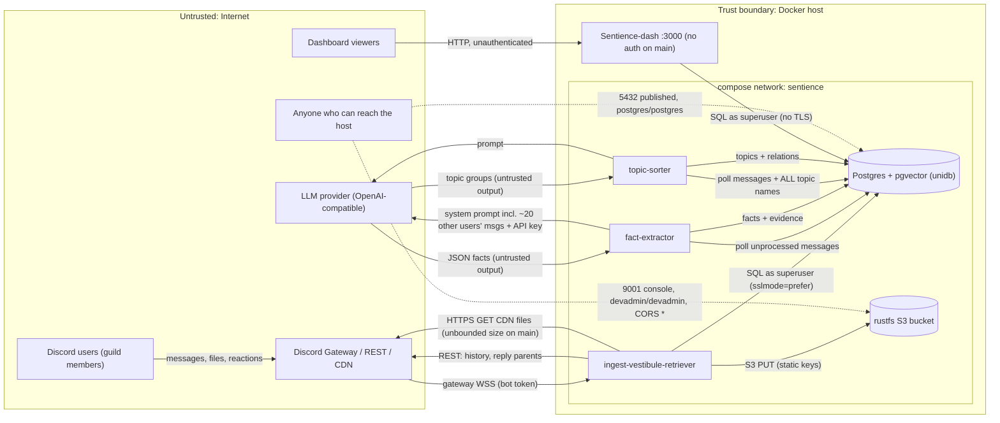

# Sentience — Threat Model

Status: initial version from the November 2026 audit (see `AUDIT_REPORT.md`). Describes `main` as of
unidb-schema `c20a146`, sentience-workers `c3432cb`, Sentience-dash `1fe79e2`. Several mitigations are in open
draft PRs; the "Current state" column describes `main`.

## Scope and assets

Components: `ingest-vestibule-retriever` (Discord bot), `fact-extractor` and `topic-sorter` (LLM workers),
Postgres + pgvector (unidb schema), rustfs (S3), `Sentience-dash` (SvelteKit).

Assets, most sensitive first:

1. LLM-inferred personal facts about Discord users (location, employer, real name, health, relationships, skills).
2. Full message history: all channels the bot can read (including private ones), edits, reactions, attachments, avatars.
3. Secrets: Discord bot token, LLM API key, Postgres credentials, S3 keys.
4. Integrity of the stored "long-term memory" (facts, topics) and service availability.

## Data flow and trust boundaries

Trust boundaries:

- **TB1** Discord → ingest: content is untrusted user input; payload *structure* is trusted (authenticated TLS gateway).
- **TB2** workers ⇄ LLM provider: third-party processor; its output is untrusted.
- **TB3** host network → published ports (5432, 9001, 3000).
- **TB4** dashboard viewers → dash.
- **TB5** shared database: every component connects as superuser, so there is effectively no internal boundary.

## STRIDE

| Threat | Where | Current state (main) | Mitigation (PR where it exists) |
|---|---|---|---|
| **S**poofing | Dash viewers | No authentication; every visitor is effectively an admin | Optional HTTP Basic auth (Sentience-dash#5); long-term: SSO / Discord OAuth admin allowlist or an authenticating reverse proxy |
| | DB / S3 | Default credentials (`postgres/postgres`, `devadmin/devadmin`) on ports published on 0.0.0.0 | Loopback-only by default (sentience-workers#3); still to do: no defaults (`${VAR:?}`), strong random secrets |
| | Postgres server identity | `sslmode=prefer` / no TLS, so a man-in-the-middle can impersonate the DB | `sslmode=verify-full` (not yet done) |
| **T**ampering | Fact store | Cross-user prompt injection: other users' messages are in the *system* prompt; facts are attributed to the focal author | Untrusted content goes in the user role as data; code-verified evidence spans; record caps (partly in the sentience-workers#7) |
| | Topic store | Attacker-shaped topic names are injected into every future prompt | Validate/cap topic names; bound the topic list (sentience-workers#7) |
| | Whole DB | Superuser everywhere; `drizzle db:push`; schema pulled unpinned from `main` | `db:push` guarded (Sentience-dash#3); schema/images pinned (sentience-workers#3); still to do: per-service least-privilege roles |
| **R**epudiation | Dash access, data changes | No access or audit logging; LLM `reasoning` is model-generated; deletes are not captured | Access logs at a proxy; `message_delete` handler; mark facts as unverified in the UI |
| **I**nformation disclosure | Dash | All messages and PII facts public; raw SQL errors shown to clients | Generic errors and input validation (Sentience-dash#5); auth |
| | Published ports | 5432 / 9001 on 0.0.0.0 | Loopback by default (sentience-workers#3) |
| | LLM provider | All content, including private channels and soft-deleted messages, plus user ids | Channel allowlist, filter deleted messages (topic-sorter: `[arch]` PR), DPA with the provider |
| | Logs | trace/debug default filters; raw LLM output and signed CDN URLs in errors | info level; redaction |
| | Transport | DB connections are plaintext or unverified | TLS `verify-full` |
| **D**enial of service | Ingest | Unbounded downloads (up to 500 MB × 10 per message), unbounded spawns, no timeouts, whole-channel buffering | Size cap and timeouts (sentience-workers#5); semaphore; streaming upload; paged scan |
| | LLM workers | Batches that always fail are re-fetched forever (head-of-line stall); topic prompt grows without bound | Bounded retries, atomic attempt rows, bounded prompts, LLM timeouts (sentience-workers#7) |
| | Dash | Heavy unauthenticated aggregate queries; SvelteKit Accept-header ReDoS | Query perf (Sentience-dash#6); patched kit (Sentience-dash#2); auth; caching |
| **E**levation of privilege | Postgres | Superuser enables `COPY … FROM PROGRAM` = code execution in the DB container | Non-superuser app roles; no published port |
| | Containers | Workers run as root; a shared `.env` gives every worker every secret | Non-root workers (sentience-workers#3); still to do: `cap_drop: ALL`, read-only rootfs, per-service secrets |

## Privacy note

The system builds persistent profiles of Discord users from their messages. That includes special categories
the fact-extraction prompt explicitly asks for (health conditions, relationship status), without consent or
notice, and with no retention or erasure path. Deleted messages are kept and can still be sent to a third-party
LLM. This is a regulatory risk (GDPR Art. 5, 6, 9, 13/14, 17, 28) and may conflict with Discord's developer
policy. Before production use, decide on: a lawful basis or opt-in, a channel allowlist, retention limits, and an
erasure workflow per user.

## Top mitigations (priority order)

1. Authenticate the dashboard; stop publishing 5432/9001; remove default credentials.
2. Least-privilege DB roles (dashboard read-only) and TLS `verify-full` to Postgres.
3. Harden LLM prompts against injection: untrusted data in the user role, code-verified evidence spans, output caps.
4. Bound ingest downloads and concurrency; HTTP timeouts.
5. Per-service secrets; non-root containers; pinned images and schema.
6. Privacy controls: handle deletions, channel allowlist, retention, erasure.
7. CI on every PR: `cargo deny check`, `cargo audit`, `bun audit --prod`, `gitleaks git`.
